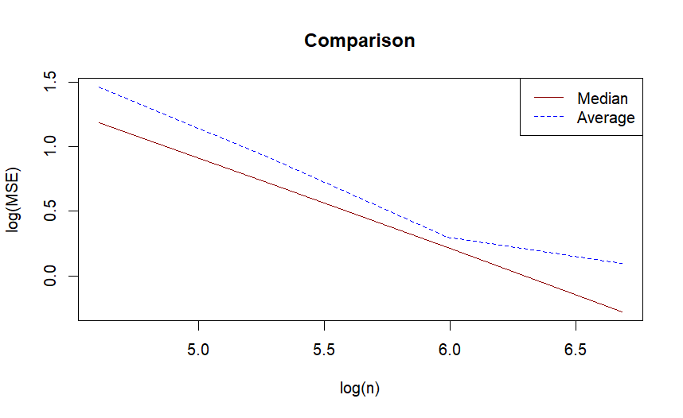
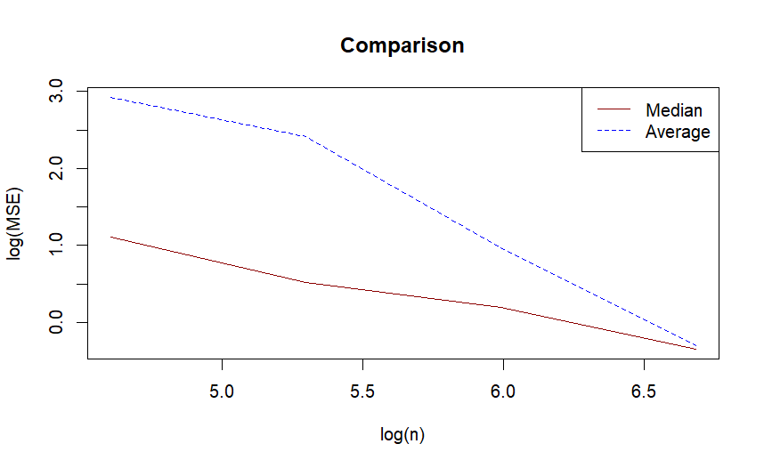

# Robust Long-Run Variance Estimation (DK-HAC)

R implementation of the **double-kernel heteroskedasticity- and autocorrelation-consistent (DK-HAC)** estimator of the long-run variance, plus a **median-based variant**, proposed in this project, for series contaminated by outliers. Both are evaluated by Monte Carlo simulation.

> Summer undergraduate research, The Chinese University of Hong Kong (Jul 2023), with Liangbang Li, supervised by [Prof. name]. Write-up: [`summary.pdf`](summary.pdf)

**What we did**
- Summarised and implemented, in R, the simultaneous-bandwidth DK-HAC estimator of Belotti, Casini, Catania, Grassi & Perron (2023).
- Implemented the sequential-bandwidth benchmark (Casini, 2021) and the prewhitening step, then attempted to reproduce the paper's simulation study.
- Proposed and tested a median-based variant that is robust to outliers.

## Why it matters

The long-run variance

$$J = \sum_{k=-\infty}^{\infty} \gamma(k)$$

is the variance of the sample mean of an autocorrelated series. It is the quantity behind HAC (Newey–West-type) standard errors. These are used whenever we test whether a return series, a regression coefficient or a strategy's alpha is significant in the presence of serial correlation.

The classical estimator assumes stationarity. Casini's DK-HAC estimator adds a second kernel that smooths over **time**, so autocovariances can evolve. This makes inference valid for nonstationary and possibly misspecified models. Both estimators are sensitive to outliers, which is what this repo addresses.

## What's implemented

| Estimator | Function | Idea |
|---|---|---|
| Classical Bartlett-kernel LRV | `JCla`, `JHat`, `JCla2` | Weighted sum of sample autocovariances, bandwidth ⌈2n^{1/3}⌉ |
| DK-HAC | `JHat1` | Local autocovariances on blocks of size n_T = T^{0.66}, smoothed over time with kernel k₂(x) = 6x(1−x). Lags are weighted with the quadratic-spectral (QS) kernel k₁. |
| Data-driven simultaneous bandwidths | `bw_opt` | Plug-in rule that jointly minimises the global MSE over both bandwidths (b₁ for lags, b₂ for time), using block-wise AR(1) approximations |
| **Median DK-HAC (proposed)** | `JHat1Med`, `bw_opt_med` | Replaces block averages with **medians**, both in the bandwidth plug-in and in the local autocovariance estimates, to limit the influence of outliers |
| Median variants (ablation) | `JHat1MedBW`, `JHat1MedcT` | Median only in bandwidth selection, or only across block autocovariances |

## Simulation design

- **Data:** AR(1) with φ = 0.5 and unit innovation variance, so the true long-run variance is J = 4. Alternative designs (MA(1), ARMA(1,1)) are included in the code as comments.
- **Contamination:** ⌈0.5·n^{1/3}⌉ observations are replaced with 3× the series minimum, and the same number with 3× the maximum.
- **Sample sizes:** n ∈ {100, 200, 400, 800}, with 1,000 replications each.
- **Metric:** mean squared error against the true J, compared on a log(MSE) vs log(n) plot (median vs average DK-HAC).

## Results

log(MSE) against log(n) for the original (average) and the proposed (median) DK-HAC estimators:

| Setting | Finding |
|---|---|
| Clean AR(1) | The median estimator has slightly lower MSE at every sample size, e.g. about 25% lower at n = 100. |
| AR(1) with jumps (outliers) | The original estimator's MSE rises sharply. The median estimator has about **6× lower MSE at n = 100–200** and about 2× lower at n = 400. The two converge at n = 800. |




**Caveat.** Replacing the kernel-weighted average of $\hat V_s \hat V_{s-k}'$ with its median biases the local autocovariance, because the product distribution is skewed. We correct the scale with a factor of $T^{1/6}$, chosen by simulation on this AR(1) design. Deriving that correction formally, and testing on other data-generating processes (MA, ARMA, regime shifts), are the main open items.

## Files

| File | Purpose |
|---|---|
| `simulation_lrv.R` | Classical Bartlett LRV (two implementations) and an MSE comparison for n = 100, 1,000, 10,000 |
| `simulbw.R` | DK-HAC estimator, data-driven bandwidth selection, contamination simulation |
| `simulbw_median.R` | Median-based (robust) DK-HAC variants |
| `simultaneousBW.R` | Direct implementation summing over all lags −T+1 … T−1 (slower; used to cross-check `JHat1`) |
| `seqbw.R` | Work in progress: sequential bandwidth selection (incomplete) |

## Run

```r
source("simulbw_median.R")   # defines JHat1Med etc.
source("simulbw.R")          # defines DK-HAC and runs the simulations
```

`simulbw.R` uses functions from `simulbw_median.R`, so source that file first. The full 1,000-replication study takes a while. Reduce `nRep` for a quick check.

Note: the plug-in constant in the bandwidth rule (`delta.hat.121`) follows the time-varying AR(1) design used in the paper's simulations.

## Reference

- Belotti, F., Casini, A., Catania, L., Grassi, S., & Perron, P. (2023). Simultaneous bandwidths determination for DK-HAC estimators and long-run variance estimation in nonparametric settings. *Econometric Reviews*, 42(3), 281–306.
- Casini, A. (2021). *Theory of Evolutionary Spectra for Heteroskedasticity and Autocorrelation Robust Inference in Possibly Misspecified and Nonstationary Models.* arXiv:2103.02981.

## Tech stack
R (base `stats`: `arima.sim`, `acf`)
